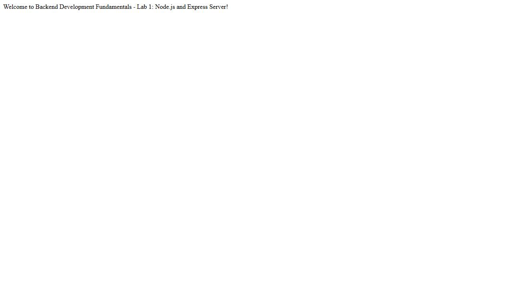
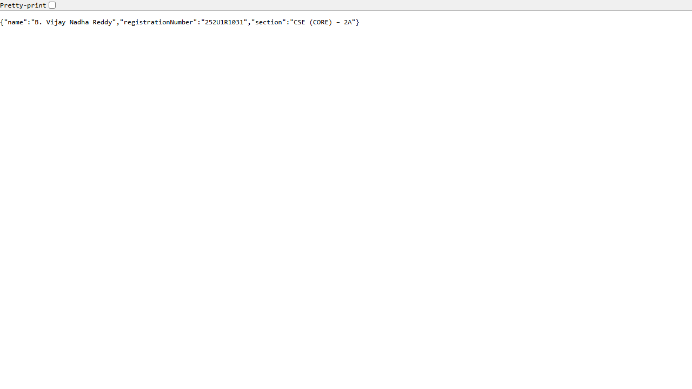
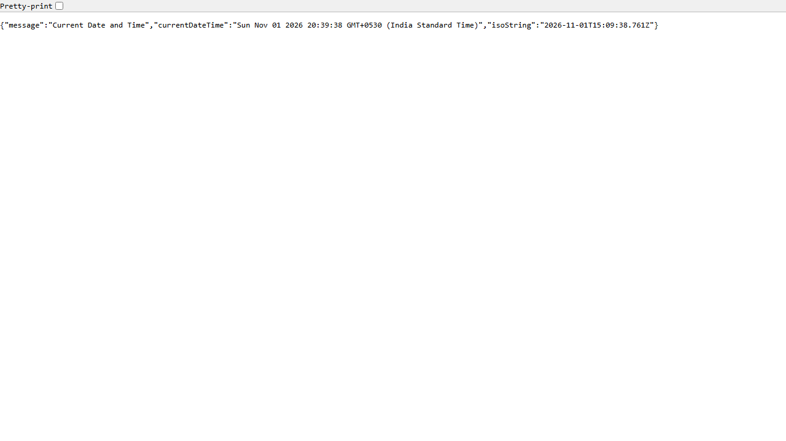
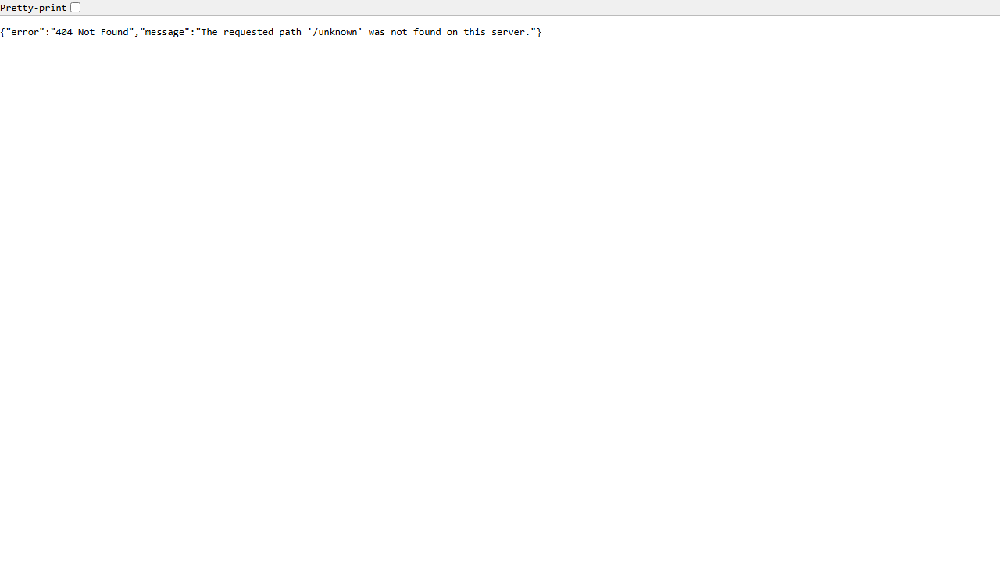

# Lab 1: Node.js and Express Server

**Live Link:** Deployment Pending

**Name:** B. Vijay Nadha Reddy

**Registration Number:** 252U1R1031

**Section:** CSE (CORE) – 2A

---

## 1. Objective

The objective of this lab is to establish a strong foundational understanding of backend development with Node.js and Express.js by:
- Initializing a structured Node.js project using `npm init -y`.
- Understanding the structure and role of `package.json` and `node_modules`.
- Constructing a fundamental HTTP server utilizing Node.js's native `http` module (`http.createServer()`).
- Installing and building a robust RESTful web server using the `Express.js` web framework.
- Creating modular endpoints responding with text and JSON payloads, including dynamic server timestamps (`new Date()`).
- Implementing a catch-all 404 handler for undefined application routes.
- Preparing the project for version control with Git, avoiding unnecessary files via `.gitignore`, and configuring it for cloud deployment on Render.

---

## 2. Technologies Used

- **Runtime Environment:** [Node.js](https://nodejs.org/) (JavaScript Runtime)
- **Web Framework:** [Express.js](https://expressjs.com/) (v4.x)
- **Core Modules:** Node.js native `http` module
- **Package Manager:** `npm` (Node Package Manager)
- **Version Control:** Git & GitHub
- **Deployment Platform:** [Render](https://render.com/) (Web Service, Node Environment)

---

## 3. Installation Instructions

Follow these steps to set up the project locally:

1. **Verify Prerequisites:**
   Ensure Node.js and npm are installed on your machine:
   ```bash
   node -v
   npm -v
   ```

2. **Navigate to the Project Directory:**
   ```bash
   cd lab-01
   ```

3. **Install Dependencies:**
   Install Express and all necessary dependencies declared in `package.json`:
   ```bash
   npm install
   ```

> **Task 2 Explanation: Where Express is located inside `node_modules`**
>
> When `npm install express` is executed:
> - Express is downloaded and stored inside the `lab-01/node_modules/express/` directory.
> - The primary entry point for Express is configured in `node_modules/express/index.js`, which imports the core application logic from `node_modules/express/lib/express.js`.
> - All transitive dependencies required by Express (such as `accepts`, `body-parser`, `content-disposition`, `cookie`, `etag`, `fresh`, `mime`, `parseurl`, `qs`, `send`, `serve-static`, etc.) are also organized within `lab-01/node_modules/`.
> - `node_modules` is excluded from Git via `.gitignore` because dependencies can be recreated at any time by running `npm install`.

---

## 4. How to Run the Project

### Running the Basic HTTP Server (Task 3)
To run the server built with the native Node.js `http` module:
```bash
node basic-server.js
```
*or via npm script:*
```bash
npm run basic
```
Open your browser and visit: `http://localhost:3000/`  
Expected response: Plain text `Hello`.

---

### Running the Express Server (Tasks 4, 5, 6)
To run the primary Express server:
```bash
node server.js
```
*or via npm script:*
```bash
npm start
```
The server will bind to the port defined by `process.env.PORT` (or default to `3000` for local testing).

---

## 5. package.json Explanation

`package.json` serves as the central manifest for a Node.js project. Here is an explanation of its key fields:

| Field | Purpose & Description |
| :--- | :--- |
| **`name`** | The unique identifier or title of the project (e.g., `"lab-01"`). Must be lowercase and URL-friendly without spaces. |
| **`version`** | Follows Semantic Versioning (`MAJOR.MINOR.PATCH`, e.g., `"1.0.0"`). Tracks release iterations. |
| **`description`** | A brief summary describing what the application or package does. |
| **`main`** | The primary entry point of the application (e.g., `"server.js"`). This file is executed when the package is imported or run. |
| **`scripts`** | A dictionary of command aliases that can be executed via `npm run <script-name>`. For example, `"start": "node server.js"` allows starting the production server with `npm start`. |
| **`dependencies`** | Lists the third-party production packages and version ranges required by the application at runtime (e.g., `"express": "^4.19.2"`). |
| **`author`** | Identifies the creator or developer responsible for the project (`"B. Vijay Nadha Reddy"`). |
| **`license`** | Defines the legal terms under which the software is shared or distributed (e.g., `"ISC"`). |

---

## 6. Endpoints Documentation

The Express server (`server.js`) exposes the following endpoints:

| Method | Endpoint | Description | Request Body | Response Format | Expected Status Code | Example Response |
| :--- | :--- | :--- | :--- | :--- | :---: | :--- |
| **GET** | `/` | Home / Welcome route | None | Plain Text | **200 OK** | `"Welcome to Backend Development Fundamentals - Lab 1: Node.js and Express Server!"` |
| **GET** | `/about` | Student details route | None | JSON | **200 OK** | `{"name":"B. Vijay Nadha Reddy","registrationNumber":"252U1R1031","section":"CSE (CORE) – 2A"}` |
| **GET** | `/time` | Server current timestamp | None | JSON | **200 OK** | `{"message":"Current Date and Time","currentDateTime":"...","isoString":"2026-11-01T..."}` |
| **GET** | `*` *(e.g., `/unknown`)* | Fallback 404 handler | Any | JSON | **404 Not Found** | `{"error":"404 Not Found","message":"The requested path '/unknown' was not found on this server."}` |

---

## 7. HTTP Status Codes

| Status Code | Meaning | Context in this Project |
| :---: | :--- | :--- |
| **`200 OK`** | The request has succeeded. | Returned for all valid GET requests (`/`, `/about`, `/time`) where the server processed and responded successfully. |
| **`404 Not Found`** | The server cannot find the requested resource. | Returned by the catch-all middleware for any endpoint that is not explicitly registered (e.g., `/unknown`, `/test`). |

---

## 8. Screenshots

> **Note on Capturing Screenshots:**
> 1. Start the server locally: `node server.js`.
> 2. Open your web browser (Chrome, Edge, Firefox).
> 3. Navigate to each endpoint in separate tabs:
>    - `http://localhost:3000/`
>    - `http://localhost:3000/about`
>    - `http://localhost:3000/time`
>    - `http://localhost:3000/unknown`
> 4. Use `Win + Shift + S` (Windows) or Developer Tools (`Ctrl + Shift + I` -> `Ctrl + Shift + P` -> "Capture full size screenshot").
> 5. Save the image files into the `lab-01/screenshots/` folder matching the filenames below.

### Home Route (`/`)


### About Route (`/about`)


### Time Route (`/time`)


### 404 Route (`/unknown`)


---

## 9. Problems Faced and Solutions

1. **Port Conflicts in Local Environments:**
   - *Problem:* Hardcoding port `3000` causes errors if port `3000` is already in use by another local application or when deployed to managed cloud providers.
   - *Solution:* Implemented dynamic port configuration using `process.env.PORT || 3000`, allowing host platforms (like Render) to inject their designated port while defaulting cleanly to `3000` locally.

2. **Accidental Committing of `node_modules`:**
   - *Problem:* `node_modules` contains thousands of files and heavy disk footprint, slowing down git operations and cluttering the repository.
   - *Solution:* Configured a root-level `.gitignore` file explicitly excluding `node_modules/` and environment configuration files (`.env`), ensuring only lightweight, clean source files are tracked.

3. **Handling Unmatched URLs (404s):**
   - *Problem:* Without a custom catch-all route, Express outputs a default generic HTML error string (`Cannot GET /path`) without a structured API response.
   - *Solution:* Added a terminal catch-all middleware `app.use((req, res) => { ... })` positioned after all valid routes that returns structured JSON with an explicit `404` status code.

---

## 10. Deployment Details

This application is fully prepared for deployment on **Render**:

- **Platform:** Render (Web Services)
- **Runtime / Language:** Node
- **Environment:** Production
- **Root Directory:** `lab-01`
- **Build Command:** `npm install`
- **Start Command:** `node server.js`
- **Instance Type:** Free
- **Port Binding:** Configured dynamically via `const PORT = process.env.PORT || 3000;`

### Steps to Deploy:
1. Create a public repository on GitHub and push the code:
   ```bash
   git add lab-01
   git commit -m "Complete Lab 1 Node.js and Express server"
   git push origin main
   ```
2. Log into [Render Dashboard](https://dashboard.render.com/).
3. Click **New +** -> **Web Service**.
4. Connect your GitHub repository.
5. In service settings, configure:
   - **Root Directory:** `lab-01`
   - **Runtime:** `Node`
   - **Build Command:** `npm install`
   - **Start Command:** `node server.js`
   - **Plan:** Free
6. Click **Deploy Web Service**.
7. Once deployment finishes successfully, copy your live Render URL (e.g. `https://lab-01-xxxx.onrender.com`) and update the **Live Link** at the top of this `README.md`.
